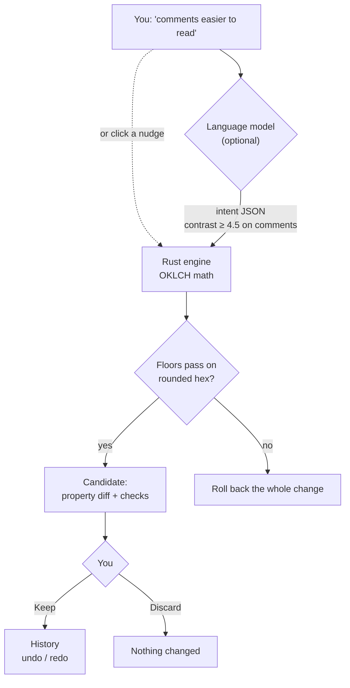
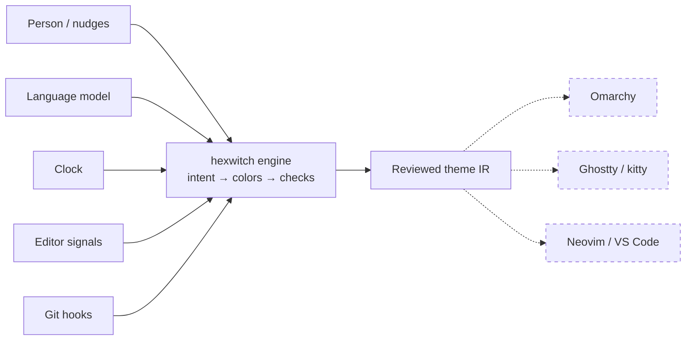
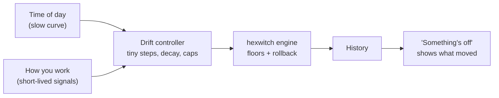

<p align="center">
  
</p>

<h1 align="center">hexwitch</h1>

<p align="center">
  <b>Tell your theme "comments easier to read".</b><br>
  The engine moves one color just past 4.5:1 and leaves the rest of the theme exactly as it was.
</p>

<p align="center">
  
  
  
  
  
</p>

<p align="center">
  <a href="#run-it">Run it</a> ·
  <a href="#how-it-works">How it works</a> ·
  <a href="#benchmarks">Benchmarks</a> ·
  <a href="#how-it-compares">Comparison</a> ·
  <a href="#build-on-it">Build on it</a> ·
  <a href="#where-this-is-going">What's next</a>
</p>

<p align="center">
  
</p>

## Run it

One command, no API key, no JavaScript build:

```sh
cargo run --manifest-path core/Cargo.toml -p hexwitch-cli -- playground
```

Open **http://127.0.0.1:7331**, pick one of the 23 Omarchy themes, and click any
token.

## How it works

Language models are good at understanding *"make it cozier"*. They are bad at
picking 40 hex values that stay readable. hexwitch splits the job at that line:
the model only proposes **intent**, and the engine does the color math.



| | |
|---|---|
| **Intent, not palettes** | The model emits operations such as `hue -20°` or `contrast ≥ 4.5`. It cannot invent a color, only pass on one you typed. |
| **Deterministic** | Same theme and same intent give the same bytes, so results can be replayed, seeded and shared. |
| **Minimal** | Only the targeted properties move. Every other role stays byte-identical. |
| **Fail closed** | If a required floor fails, the whole candidate rolls back and the report names what failed. |
| **Locks and rules** | Lock a property and nothing touches it. "Comments stay ≥ 4.5:1" is stored and checked on every later edit. |

<p align="center">
  
</p>

When a request is ambiguous, the model asks instead of guessing:

<p align="center">
  
</p>

<details>
<summary><b>The same edit from the shell</b></summary>

<br>

```console
$ cat quieter.json
{"version":1,"actions":[
  {"op":"lock","target":{"roles":["surface.base"],"property":"bg"}},
  {"op":"hue","target":{"roles":["syntax.keyword"],"property":"fg"},"degrees":-20},
  {"op":"contrast","target":{"roles":["syntax.comment"],"property":"fg"},
   "backgrounds":[{"surface":"surface.base","overlays":[]}],"min":4.5}
]}

$ hexwitch --machine revise --spec quieter.json tokyo-night.json
outcome: satisfied
  syntax.comment  fg  #565f89 → #7781ae    2.76:1 → 4.51:1
  syntax.keyword  fg  #bb9af7 → #9ea5ff
  12 other roles unchanged
```

The JSON envelope is abridged. Other commands to try: `contrast '#c0caf5'
'#1a1b26'`, `convert '#7aa2f7'`, and `map 0.7 0.4 250`, which pulls an
out-of-gamut OKLCH color into sRGB and keeps its hue.

</details>

## Benchmarks

Apple M4, release build, median of 30 runs. Each time **includes process
start-up**, so the engine's own share is smaller.

| Operation | Median |
|---|---:|
| `contrast` / `map` one color | 2.0 ms |
| `revise`: four actions and a contrast floor | 3.9 ms |
| `validate` calculated scenes | 2.7 ms |
| `import` VS Code Dark+ with its included base | 11.0 ms |
| `eval-interpretation`: all 74 matrix cases | 37.9 ms |

An edit takes less than one 60 Hz frame. That is fast enough for a theme that
recomputes itself every few seconds ([see below](#where-this-is-going)). The
binary is about 4 MB with no runtime dependencies.

## How it compares

We found no other tool that edits an existing theme from a plain-language
request with contrast guarantees.

| | Edits your theme | Perceptual math | Enforces contrast | Model picks colors | Writes app configs |
|---|:---:|:---:|:---:|:---:|:---:|
| **hexwitch** | ✅ minimal, reviewed | ✅ OKLCH | ✅ with rollback | ❌ intent only | ❌ not yet |
| [themer](https://github.com/mjswensen/themer), [Base16](https://github.com/tinted-theming), [Whiskers](https://github.com/catppuccin/whiskers) | ❌ | ❌ | ❌ | no model | ✅ many apps |
| [pywal](https://github.com/dylanaraps/pywal), [wallust](https://codeberg.org/explosion-mental/wallust), [matugen](https://github.com/InioX/matugen) | ❌ from wallpaper | matugen | matugen | no model | ✅ many apps |
| [Adobe Leonardo](https://leonardocolor.io) | ❌ | ✅ | ✅ | no model | UI scales only |
| [Zed theme builder](https://zed.dev/docs/themes) | ✅ by hand | ❌ | ❌ | no model | Zed |
| [Themery](https://hunted.space/product/themery) | not documented | not documented | ✅ WCAG + APCA | ✅ whole palette | ✅ editors, terminals |

**Where others are ahead:** they write files your apps load today, hexwitch
doesn't yet. Themery and color.js also check APCA, and pywal and matugen can
start from an image. This table reflects public documentation as of October 2026.

## Evaluation

The suites check meaning, not exact JSON or hex values. A response is judged
on what it **proposed** as well as the final theme, so an unsafe unlock that a
later rule happened to roll back still fails.

| Suite | Size | Result |
|---|---|---|
| Semantic matrix | 74 cases from 50 requests, state variants, a paraphrase, 8 multi-turn sequences | 74/74 on the authored replay |
| Pair checks | strength order, paraphrase equivalence, unrelated roles untouched | 3/3 |
| Known-bad probes | 13 deliberately wrong responses | 13/13 caught |
| Import fixtures | 5 pinned files + 3 states, byte hashes and licenses | verified |
| Live model | small model on a compatible gateway | ⚠️ still fails after a saturation question |

The replay is hand-written, so 74/74 shows the evaluator works. It says nothing
about any model. Running several models on unseen, independently labeled
requests is the next gate.
[Methodology](core/eval/README.md) · [Status](docs/status.md)

## Build on it

Anything that can say *"a little warmer"* or *"keep this ≥ 4.5:1"* can drive a
theme. Every input goes through the same floors and rollback, so odd inputs
still give readable results.



Dashed targets are planned, not built. There are three ways in today:

| Way in | What you get |
|---|---|
| **CLI with `--machine`** | Every command returns a versioned JSON envelope with stable error codes. `capabilities` lists supported features. |
| **`hexwitch-core` crate** | Color math, IR, import, revision, validation, sessions and evaluators. No network or UI code, and only four dependencies (serde, serde_json, thiserror, sha2). |
| **Experiment contract** | The propose → review → keep → undo loop the playground uses, documented in [experiment-v1](docs/contracts/experiment-v1.md). |

## Where this is going

The playground is the test bench. The point is what runs on top of the engine:

| | Idea | How the engine makes it work |
|---|---|---|
| 🎲 | **I'm feeling lucky.** One button rolls a few random intents onto a good theme and adds a fortune: *"Kanagawa, but cooler, with louder strings."* | Deterministic, so seed `7f3a` gives everyone the same theme. Seed it with the date and you get a theme of the day. |
| 🌗 | **A theme that lives through your day.** Crisp in the morning, softer at night. Stay in one function and the rest goes quiet. Open TODOs warm the background, and passing tests bring a faint glow. | Each signal becomes a tiny intent that wears off. The contrast floor always holds. |
| 🕵️ | **Something's off.** The theme drifts too slowly to notice. Press the button when you catch it and see what moved and why: *"comments −3%, no new comments since Tuesday."* | Every step is in the undo history, which doubles as the evidence. |



These need two things that don't exist yet: the drift controller, and emitters
that write themes into real apps. Omarchy comes first because its 23 themes
already load as references. See [FUTURE_PLAN.md](FUTURE_PLAN.md).

## Playground guide

<details>
<summary><b>Your first five minutes</b> (offline, no key)</summary>

<br>

- [ ] **Pick a theme** from the 23 [Omarchy](https://github.com/basecamp/omarchy)
      themes, or the built-in Eval ink/paper reference.
- [ ] **Click a keyword.** Press *warmer* twice and *more vivid* once.
- [ ] **Hold Space** to see the original, then read the review card.
- [ ] **Keep**, then **⌘Z** to step back and **⇧⌘Z** to step forward.
- [ ] **Switch the scene**: TypeScript, Rust, Python or Go, under normal,
      selection, search, diff and floating views.

Pass `--port 0` to pick any free port. The host listens on loopback only, keeps
one experiment in memory and stops with Ctrl-C. Use **More → Save session** to
keep your work.

</details>

<details>
<summary><b>Connect a model</b></summary>

<br>

Open **Connect a model** from the welcome card, the model chip, or **More →
Providers & models**. Pick OpenAI, OpenRouter, Ollama, LM Studio or any
OpenAI-compatible API root, add a key, and choose models from the provider's
catalog. Nothing is sent until you pick a model and press send. Choose
**Offline** to see the exact prompt without sending it.

Providers are saved to `~/.config/hexwitch/providers.json` (override with
`$XDG_CONFIG_HOME`, `$HEXWITCH_PROVIDERS_FILE` or `--providers-file`). The file
stores key variable names only. Pasted keys stay in memory and are never written
to disk, sent to the browser or exported. Automatic retries are disabled.

hexwitch appends `/chat/completions` and `/models` to the API root and does not
add `/v1`, so include it if your gateway needs it. Launch flags register a
read-only provider:

```sh
cargo run --manifest-path core/Cargo.toml -p hexwitch-cli -- playground \
  --base-url http://slingring.procol.tech \
  --api-key-env SLINGRING_API_KEY \
  --model FAST_SMALLER
```

</details>

<details>
<summary><b>Everything the engine can do</b></summary>

<br>

| Area | Capabilities |
|---|---|
| Color | sRGB ↔ OKLCH, gamut mapping that keeps hue, WCAG contrast on rounded output, opacity and alpha compositing |
| Theme model (IR v1) | Roles with fg/bg/special, opacity, bold/italic/underline/strikethrough, explicit states, per-property locks, provenance, semantic modifier and language rules |
| Import | VS Code JSON/JSONC with includes, semantic precedence checked against VS Code 1.95.0, a report of anything lost |
| Revision | `lock`, `unlock`, `set_color`, `set_number`, `set_bool`, `set_underline`, `state`, `lightness`, `chroma`, `hue`, `contrast`; persistent constraints; all-or-nothing rollback |
| Interpretation | Any OpenAI-compatible API, a strict schema per operation, clarifying questions, refusals, dry run |
| Validation | Calculated scenes (normal, selection, search, diff, floating) |
| Experiments | Review before accept, undo/redo, stale-revision rejection, resumable questions, export and restore |

</details>

## For developers

| Path | Purpose |
|---|---|
| `core/crates/hexwitch-core/` | Color math, IR, import, semantic resolution, intent, validation, sessions, evaluators |
| `core/crates/hexwitch-cli/` | CLI, compatible API transport, loopback playground host |
| `playground/` | Browser UI and opt-in browser smoke test |
| `core/eval/` | References, semantic contracts, replay runs, mutations, fixture verification |
| `docs/` | Status, playground internals, engine and experiment contracts |

Enable the git hooks once per clone with `git config core.hooksPath .githooks`.
Pre-commit runs `fmt` and `clippy`. Pre-push runs the fixture checks, the Rust
and Python tests, and the browser smoke test when Playwright is on `NODE_PATH`.

<details>
<summary><b>Run the checks by hand</b></summary>

<br>

```sh
cargo fmt --manifest-path core/Cargo.toml --all --check
cargo clippy --manifest-path core/Cargo.toml --all-targets --locked -- -D warnings
cargo test --manifest-path core/Cargo.toml --all --locked
python3 core/eval/verify-fixtures.py
python3 -m unittest discover -s core/eval -p 'test_*.py'
```

See [playground verification and limitations](docs/playground.md) for the
browser checks. Live model testing is opt-in.

</details>

## Known limits

- No editor adapters or emitters yet. Import loads a reference; it isn't an
  editor integration.
- The browser preview shows theme roles. It doesn't prove how an editor renders
  them.
- A schema-valid but wrong model edit can still reach review, so read the diff.
- WCAG contrast is a calculation, not a measure of comfort.

---

[Status](docs/status.md) ·
[Future plan](FUTURE_PLAN.md) ·
[IR/intent contract](docs/contracts/ir-v1.md) ·
[Experiment contract](docs/contracts/experiment-v1.md) ·
[Evaluation methodology](core/eval/README.md)
