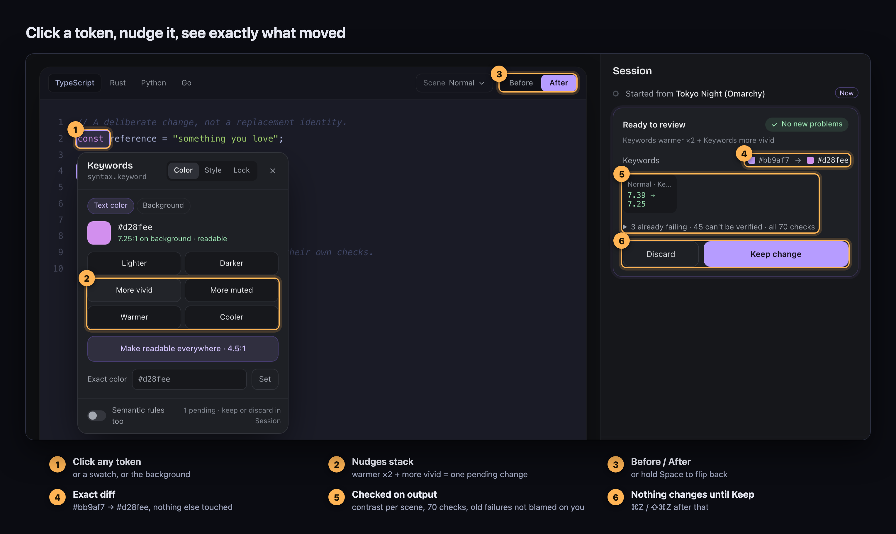
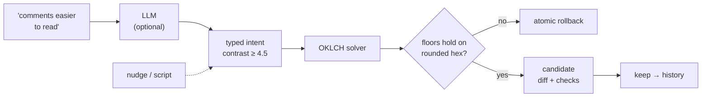
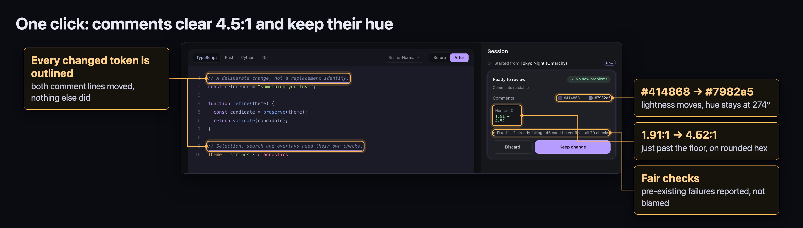
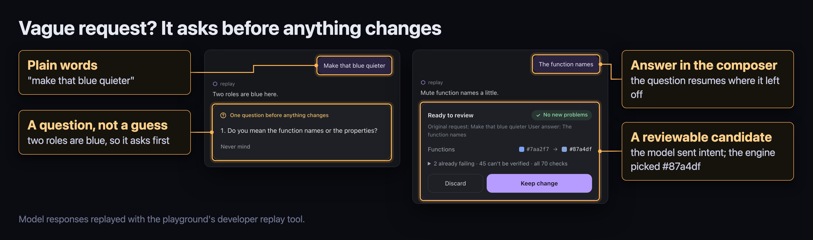
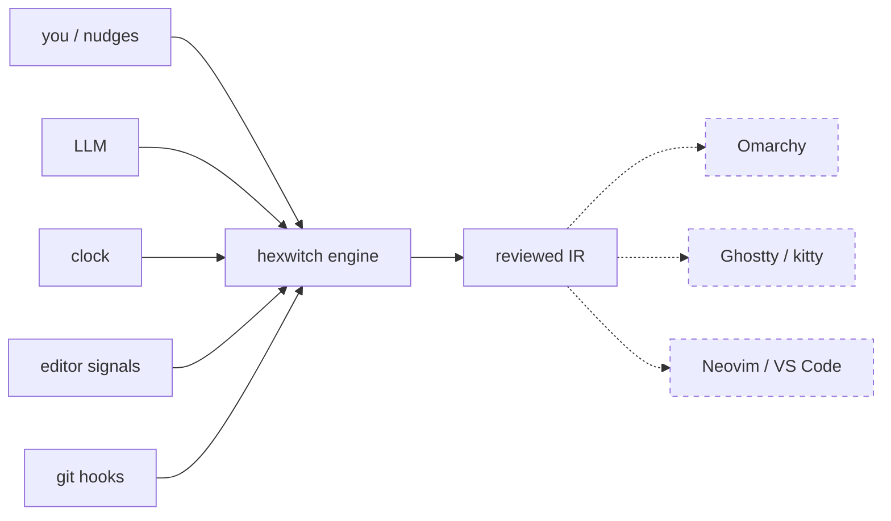

<p align="center">
  
</p>

<h1 align="center">hexwitch</h1>

<p align="center">
  <b>A programmable color engine for every theme you use.</b><br>
  Plain words or scripts in, typed intent through a Rust OKLCH solver, contrast-proven themes out.<br>
  The model never picks a hex. The engine never ships a change that breaks a floor.
</p>

<p align="center">
  
  
  
  
  
</p>

<p align="center">
  <a href="#run-it">Run it</a> ·
  <a href="#how-it-works">How it works</a> ·
  <a href="#benchmarks">Benchmarks</a> ·
  <a href="#how-it-compares">Comparison</a> ·
  <a href="#evals">Evals</a> ·
  <a href="#what-were-building">What we're building</a>
</p>

<p align="center">
  
</p>

## Run it

```sh
cargo run --manifest-path core/Cargo.toml -p hexwitch-cli -- playground
```

Open **http://127.0.0.1:7331**, load any of the 23 Omarchy themes and click a
token. No API key and no JavaScript build needed.

## How it works



Language models are good at reading intent and bad at choosing forty hex values
that stay legible. hexwitch keeps the model on the side it's good at. The model
fills a strict JSON schema with one branch per operation (`lightness`, `chroma`,
`hue`, `contrast`, `lock`, `set_*`, `state`), and colors it invents are rejected.
The solver does the rest:

- **Deterministic.** The same IR and intent always produce the same bytes, so
  every result can be replayed, seeded, diffed and shared.
- **Minimal edits.** Only the targeted `(role, property)` pairs move. Every other
  role stays byte-identical.
- **Contrast checked on what ships.** WCAG ratios are measured on the rounded
  sRGB output, against role-referenced backdrops that follow later surface edits
  and composite opacity.
- **Fail closed.** If a required floor can't be met, the whole candidate rolls
  back and the report names the failing property and semantic context.
- **Constraints persist.** Per-property locks, and rules such as "comments ≥ 4.5:1
  on `surface.base`", are stored in the theme and enforced on every later edit.

<p align="center">
  
</p>

<p align="center">
  
</p>

<details>
<summary><b>The same edit as a script</b></summary>

<br>

```console
$ cat quieter.json
{"version":1,"actions":[
  {"op":"lock","target":{"roles":["surface.base"],"property":"bg"}},
  {"op":"hue","target":{"roles":["syntax.keyword"],"property":"fg"},"degrees":-20},
  {"op":"contrast","target":{"roles":["syntax.comment"],"property":"fg"},
   "backgrounds":[{"surface":"surface.base","overlays":[]}],"min":4.5}
]}

$ hexwitch --machine revise --spec quieter.json tokyo-night.json
outcome: satisfied
  syntax.comment  fg  #565f89 → #7781ae    2.76:1 → 4.51:1
  syntax.keyword  fg  #bb9af7 → #9ea5ff
  12 other roles unchanged
```

The JSON envelope is abridged. The contrast solver searches lightness along a
fixed hue with gamut mapping (4096 samples per direction, then 24 refinement
steps) and stops at the first value that clears the floor after rounding.

</details>

## Benchmarks

Apple M4, release build, median of 30 runs, **including process start-up**.

| Operation | Median |
|---|---:|
| `contrast` / `map` one color | 2.0 ms |
| `revise`: four actions + a contrast floor | 3.9 ms |
| `validate` calculated scenes | 2.7 ms |
| `import` VS Code Dark+ with its included base | 11.0 ms |
| `eval-interpretation`: all 74 matrix cases | 37.9 ms |

A full revise, including spawning the process, finishes inside one 60 Hz frame.
That leaves room to re-solve a theme continuously from live signals. The binary
is about 4 MB, and `hexwitch-core` depends only on serde, serde_json, thiserror
and sha2.

## How it compares

✅ yes · 🟡 partial · ❌ no or not documented

| Capability | hexwitch | themer | Base16 / Whiskers | pywal / matugen | Leonardo | Zed builder | Themery |
|---|:---:|:---:|:---:|:---:|:---:|:---:|:---:|
| Edits an existing theme | ✅ | ❌ | ❌ | ❌ | ❌ | ✅ | ❌ |
| Plain-language requests | ✅ | ❌ | ❌ | ❌ | ❌ | ❌ | ✅ |
| Model limited to typed intent | ✅ | ❌ | ❌ | ❌ | ❌ | ❌ | ❌ |
| Perceptual color math | ✅ | ❌ | ❌ | 🟡 | ✅ | ❌ | ❌ |
| Enforces a contrast floor | ✅ | ❌ | ❌ | 🟡 | ✅ | ❌ | ✅ |
| Rolls back a failed edit | ✅ | ❌ | ❌ | ❌ | ❌ | ❌ | ❌ |
| Untouched roles stay byte-identical | ✅ | ❌ | ❌ | ❌ | ❌ | 🟡 | ❌ |
| Locks and persistent constraints | ✅ | ❌ | ❌ | ❌ | ❌ | ❌ | ❌ |
| Deterministic output | ✅ | ✅ | ✅ | ✅ | ✅ | ✅ | ❌ |
| Review, undo and redo | ✅ | ❌ | ❌ | ❌ | ❌ | 🟡 | ❌ |
| Evaluates model interpretations | ✅ | ❌ | ❌ | ❌ | ❌ | ❌ | ❌ |
| APCA contrast | ❌ | ❌ | ❌ | ❌ | 🟡 | ❌ | ✅ |
| Palette from an image | ❌ | ❌ | ❌ | ✅ | ❌ | ❌ | ❌ |
| Writes app configs | ❌ | ✅ | ✅ | ✅ | 🟡 | 🟡 | ✅ |

Links: [themer](https://github.com/mjswensen/themer) ·
[Base16](https://github.com/tinted-theming) ·
[Whiskers](https://github.com/catppuccin/whiskers) ·
[pywal](https://github.com/dylanaraps/pywal) ·
[matugen](https://github.com/InioX/matugen) ·
[Leonardo](https://leonardocolor.io) ·
[Zed](https://zed.dev/docs/themes) ·
[Themery](https://hunted.space/product/themery). Based on public documentation
as of October 2026.

The bottom rows are the gap we're closing next. The rows above them are what no
one else has.

## Evals

The model is graded on **what it meant**, not on matching exact JSON. Every
response is scored against semantic predicates: what must change, what must not,
which locks hold, whether contrast was requested in the right context, and how
strong the edit was. Proposed actions are judged too, so an unsafe unlock that a
later rule happened to roll back still fails.

| Suite | Coverage | Result |
|---|---|---|
| Semantic matrix | 50 requests, 15 state variants, paraphrases, 8 multi-turn sequences | 74 / 74 |
| Pair checks | "a bit" < "much", paraphrase ≡ original, unrelated roles untouched | 3 / 3 |
| Known-bad probes | wrong answers planted to trip each detector | 13 / 13 caught |

These runs replay hand-authored responses. They prove the grader, not a model.
Next is a model leaderboard: several providers on unseen, independently labeled
requests, with variance across repeated runs. A small model already handles
italics removal, comment contrast and ambiguous "blue" questions in live runs.
Its open weak spot is follow-ups about saturation. More in
[Methodology](core/eval/README.md) and [Status](docs/status.md).

## What we're building

The engine is the foundation. The playground is where we test it. The real
product is what runs on top: any signal that can say *"a little warmer"* becomes
a theme change that is checked and reversible, across the editor, the terminal
and the desktop.



| | |
|---|---|
| 🎲 **I'm feeling lucky** | One button rolls random intents onto a good theme with a fortune: *"Kanagawa, but cooler, with louder strings."* Determinism means seed `7f3a` gives everyone the same result. Seed it with the date and you get a theme of the day. |
| 🌗 **A theme that lives through your day** | Crisp in the morning, softer at night. Stay in one function and the rest goes quiet. Open TODOs warm the background, and passing tests bring a faint glow. Each signal is a tiny intent that decays, and the floor always holds. |
| 🕵️ **Something's off** | The theme drifts too slowly to notice. When you catch it, one button shows what moved and why: *"comments −3%, no new comments since Tuesday."* The undo history is the evidence. |
| ⛳ **Theme golf** | Reach a target theme in the fewest plain-language requests. Deterministic math makes the scoring fair. |

On the roadmap: a drift controller that turns signals into small intents with
decay and caps, emitters for Omarchy first and then Ghostty, kitty, Neovim and
VS Code, and the multi-model leaderboard. See [FUTURE_PLAN.md](FUTURE_PLAN.md).

## Build on it

| Interface | What you get |
|---|---|
| **CLI, `--machine`** | Versioned JSON envelope with `outcome`, `result`, stable error codes and warnings. `capabilities` reports supported IR, intent, schema and eval features. |
| **`hexwitch-core`** | Color math, IR v1, VS Code import with semantic-token precedence, revision, validation, sessions and evaluators. No network or UI code. |
| **Experiment contract** | The propose → review → keep → undo loop with stale-revision rejection and resumable questions ([experiment-v1](docs/contracts/experiment-v1.md)). |

```sh
hexwitch --machine capabilities
hexwitch --machine import theme.json --out ir.json
hexwitch --machine revise --spec intent.json ir.json --report-json report.json
hexwitch --machine interpret --v1 --dry-run ir.json "keywords warmer"
hexwitch --machine validate ir.json
```

## Playground guide

<details>
<summary><b>First five minutes</b> (offline, no key)</summary>

<br>

- [ ] **Pick a theme** from the 23 [Omarchy](https://github.com/basecamp/omarchy)
      themes or the built-in Eval ink/paper reference.
- [ ] **Click a keyword.** Press *warmer* twice and *more vivid* once.
- [ ] **Hold Space** to see the original, then read the review card.
- [ ] **Keep**, then **⌘Z** to step back and **⇧⌘Z** to step forward.
- [ ] **Switch the scene**: TypeScript, Rust, Python or Go, under normal,
      selection, search, diff and floating views.

`--port 0` picks any free port. The host listens on loopback only, keeps one
experiment in memory and stops with Ctrl-C. **More → Save session** exports it.

</details>

<details>
<summary><b>Connect a model</b></summary>

<br>

Open **Connect a model** from the welcome card, the model chip, or **More →
Providers & models**. Pick OpenAI, OpenRouter, Ollama, LM Studio or any
OpenAI-compatible API root, add a key, and choose models from the provider's
catalog. Nothing is sent until you pick a model and press send. **Offline**
shows the exact prompt without sending it.

Providers are saved to `~/.config/hexwitch/providers.json` (override with
`$XDG_CONFIG_HOME`, `$HEXWITCH_PROVIDERS_FILE` or `--providers-file`). The file
stores key variable names only. Pasted keys stay in memory and are never written
to disk, sent to the browser or exported. Automatic retries are disabled.

hexwitch appends `/chat/completions` and `/models` to the API root and does not
add `/v1`. Launch flags register a read-only provider:

```sh
cargo run --manifest-path core/Cargo.toml -p hexwitch-cli -- playground \
  --base-url http://slingring.procol.tech \
  --api-key-env SLINGRING_API_KEY \
  --model FAST_SMALLER
```

</details>

<details>
<summary><b>Full engine capabilities</b></summary>

<br>

| Area | Capabilities |
|---|---|
| Color | sRGB ↔ OKLCH, hue-preserving gamut mapping, WCAG contrast on rounded output, opacity and alpha compositing |
| IR v1 | Roles with fg/bg/special, opacity, bold/italic/underline/strikethrough, explicit `inherit`/`clear` states, per-property locks, provenance, semantic modifier and language rules, role relationships |
| Import | VS Code JSON/JSONC with includes, semantic precedence checked against VS Code 1.95.0, loss reports |
| Revision | `lock`, `unlock`, `set_color`, `set_number`, `set_bool`, `set_underline`, `state`, `lightness`, `chroma`, `hue`, `contrast`; persistent constraints; atomic rollback |
| Interpretation | OpenAI-compatible transport, per-operation schema, user-typed color anchors only, clarification and refusal, dry run |
| Validation | Calculated scenes: normal, selection, search, diff, floating |
| Experiments | Review before accept, undo/redo, stale-revision rejection, resumable questions, export and restore |

</details>

## For developers

| Path | Purpose |
|---|---|
| `core/crates/hexwitch-core/` | Color math, IR, import, semantic resolution, intent, validation, sessions, evaluators |
| `core/crates/hexwitch-cli/` | CLI, compatible API transport, loopback playground host |
| `playground/` | Browser UI and opt-in browser smoke test |
| `core/eval/` | References, semantic contracts, replay runs, mutations, fixture verification |
| `docs/` | Status, playground internals, engine and experiment contracts |

Run `git config core.hooksPath .githooks` once per clone. Pre-commit runs `fmt`
and `clippy`. Pre-push runs the fixture checks, the Rust and Python tests, and
the browser smoke test when Playwright is on `NODE_PATH`.

<details>
<summary><b>Run the checks by hand</b></summary>

<br>

```sh
cargo fmt --manifest-path core/Cargo.toml --all --check
cargo clippy --manifest-path core/Cargo.toml --all-targets --locked -- -D warnings
cargo test --manifest-path core/Cargo.toml --all --locked
python3 core/eval/verify-fixtures.py
python3 -m unittest discover -s core/eval -p 'test_*.py'
```

See [playground verification and limitations](docs/playground.md) for the
browser checks. Live model testing is opt-in.

</details>

## Today's edges

Emitters are next, so themes stay in IR for now. The preview renders roles, not a
real editor. A schema-valid but wrong model edit can reach review, which is why
review exists. WCAG is a calculation, not a comfort study.

---

[Status](docs/status.md) ·
[Future plan](FUTURE_PLAN.md) ·
[IR/intent contract](docs/contracts/ir-v1.md) ·
[Experiment contract](docs/contracts/experiment-v1.md) ·
[Evaluation methodology](core/eval/README.md)
