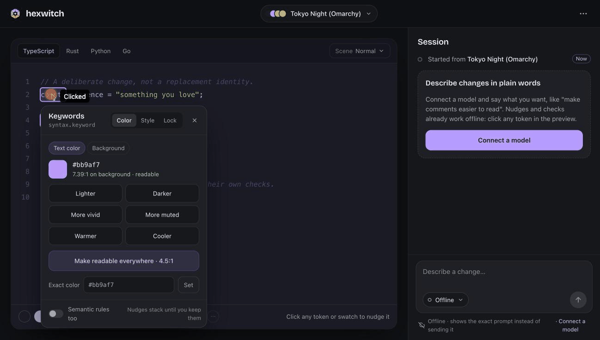
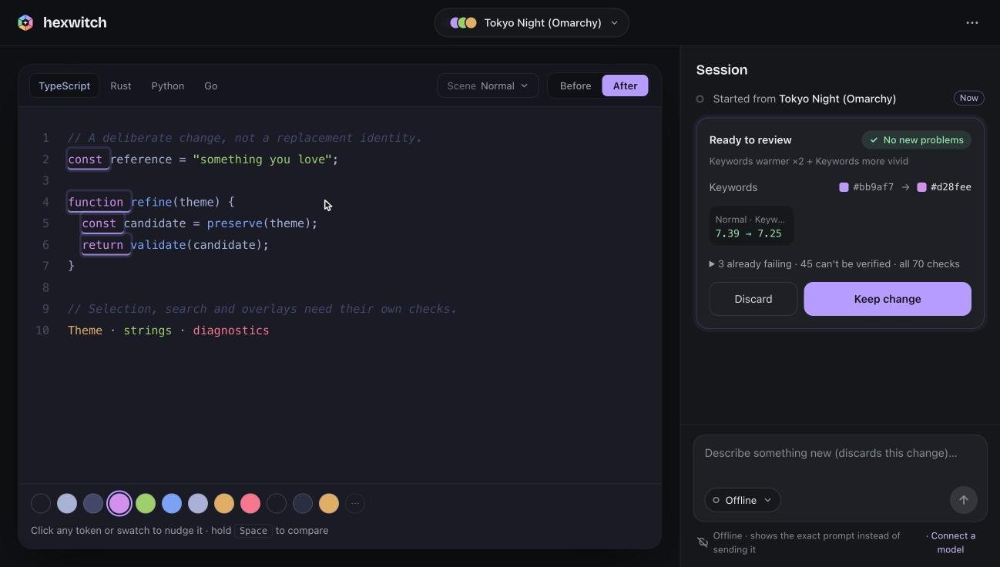

<p align="center">
  
</p>

<h1 align="center">hexwitch</h1>

<p align="center">
  Change a color theme one decision at a time.<br>
  Ask for a change, see exactly what moved, then keep it or throw it away.
</p>

<p align="center">
  <a href="#run-it-in-one-command">Quick start</a> ·
  <a href="#your-first-five-minutes">First five minutes</a> ·
  <a href="#try-the-engine-from-your-shell">Shell tour</a> ·
  <a href="#engine-boundaries">How it works</a> ·
  <a href="docs/status.md">Status</a>
</p>

---

Say *"make the comments quieter"* or *"keywords a touch warmer"*. A language model
turns your words into an intent. The Rust engine computes the new colors, checks
contrast, and shows you a property-by-property diff. Nothing changes until you
press **Keep**.

The model proposes intent, not a replacement palette. You can also skip the model
entirely: click any token and nudge it by hand.

<p align="center">
  
</p>

> **Scope:** hexwitch is a theme engine, a browser playground and an evaluation
> suite. It does not ship editor adapters, colorscheme emitters or release
> packages. Theme-file import is a way to load a reference, not an editor
> integration.

## Run it in one command

You need a Rust toolchain and a browser. Live model requests also need `curl`.
There is no JavaScript build step, no plugin and no editor configuration.

```sh
cargo run --manifest-path core/Cargo.toml -p hexwitch-cli -- playground
```

Open **http://127.0.0.1:7331**. Pass `--port 0` to pick any free port; the host
prints the URL.

The host listens on loopback only, keeps one experiment in memory and stops with
Ctrl-C. Export your session before stopping if you want to come back to it.

## Your first five minutes

Everything in this list works offline. No API key needed.

- [ ] **Pick a starting theme.** Open the theme picker and search the 23 official
      [Omarchy](https://github.com/basecamp/omarchy) themes, or start from the
      built-in Eval ink/paper reference.
- [ ] **Click a keyword in the preview.** A popover opens. Press *warmer* twice
      and *more vivid* once. Each nudge stacks onto the pending change.
- [ ] **Hold Space.** The preview flips back to the original while you hold it.
- [ ] **Read the review card.** It lists every property that changed and compares
      validation with the current theme. A failure that was already there is not
      blamed on your edit.
- [ ] **Press Keep**, then **⌘Z**. You are back where you started. **⇧⌘Z** brings
      the change back.
- [ ] **Switch the scene.** Preview TypeScript, Rust, Python or Go under normal,
      selection, search, added-line and floating scenes, and check that your
      change still reads well in each.

To describe changes in words instead, [connect a model](#connect-a-model).

## What you can do

<p align="center">
  
</p>

| Action | How |
|---|---|
| **Talk** | Describe a change in the composer. The model chip picks the provider and model. Choose **Offline** to see the exact prompt without sending it. Clarifying questions appear in the session; answer them in the composer. |
| **Nudge** | Click any token, swatch or the background. Options: lighter/darker, more vivid/muted, warmer/cooler, a 4.5:1 readability floor, an exact color, typography, underline, opacity, locks and optional semantic rules. |
| **Review** | Changed tokens are outlined. Toggle Before/After or hold Space. **Keep** asks for a second look ("Keep anyway") only when a check got worse. |
| **Go back** | Every kept change is a step in the session. Jump to any step, or use ⌘Z / ⇧⌘Z. |
| **Watch a request** | A live card shows elapsed time (confirmed by the engine every second), what the request is waiting on, and a **Stop** button that kills the request. |
| **Recover from errors** | A bad key, unknown model, timeout or unreachable host becomes a card that says what went wrong, with **Try again**, **Change model** and **Providers**. |
| **Bring your own theme** | Import IR or theme JSON/JSONC as a reference. |
| **Save your work** | **More → Save/Open session** exports and restores everything, including a pending candidate and any open question. |

### Keyboard shortcuts

| Keys | Does |
|---|---|
| <kbd>Space</kbd> (hold) | Show the theme before the pending change |
| <kbd>⌘</kbd> <kbd>Z</kbd> | Step back through kept changes |
| <kbd>⇧</kbd> <kbd>⌘</kbd> <kbd>Z</kbd> | Step forward |

## Connect a model

Nudges, checks and history work without one. To describe changes in plain words,
open **Connect a model** from the welcome card, the model chip, or
**More → Providers & models**, then follow three steps:

1. **Pick a provider.** OpenAI, OpenRouter, a server on this machine (Ollama,
   LM Studio), or any OpenAI-compatible API root such as a team gateway.
2. **Add your key.** Name an environment variable the engine can read
   (recommended; the page tells you whether it is set), or paste a key that the
   engine keeps in memory until it stops. Local servers need no key.
3. **Build your model list.** The engine fetches the provider's catalog without
   sending any prompt data. Pick the models you use and star a default. They
   appear under the model chip next to the composer.

Nothing is sent until you pick a model and press send. The composer always names
the host it sends to.

<details>
<summary><b>Where are providers saved, and what happens to my key?</b></summary>

<br>

Providers are saved to `~/.config/hexwitch/providers.json`. Override the location
with `$XDG_CONFIG_HOME`, `$HEXWITCH_PROVIDERS_FILE` or `--providers-file`.

The file stores key **variable names only**. Pasted keys are never written to
disk, sent to the browser or exported. HTTP endpoints work but are unencrypted.
Automatic retries are disabled.

</details>

<details>
<summary><b>My gateway's URL doesn't work</b></summary>

<br>

hexwitch appends `/chat/completions` and `/models` to the API root you enter. It
does not add `/v1`, so include it yourself if your gateway needs it, for example
`https://gateway.example.com/v1`.

</details>

<details>
<summary><b>Can I configure a provider from the command line?</b></summary>

<br>

Yes. Launch flags show up as a read-only provider that is selected on start:

```sh
cargo run --manifest-path core/Cargo.toml -p hexwitch-cli -- playground \
  --base-url http://slingring.procol.tech \
  --api-key-env SLINGRING_API_KEY \
  --model FAST_SMALLER
```

</details>

## Try the engine from your shell

The color math behind the playground is also a CLI. A few commands to try:

```console
$ cargo run -q --manifest-path core/Cargo.toml -p hexwitch-cli -- contrast '#c0caf5' '#1a1b26'
#c0caf5 on #1a1b26: 10.59:1  (AAA)

$ cargo run -q --manifest-path core/Cargo.toml -p hexwitch-cli -- convert '#7aa2f7'
oklch(0.71898 0.13216 264.20)

$ cargo run -q --manifest-path core/Cargo.toml -p hexwitch-cli -- map 0.7 0.4 250
#3fa3ff  (oklch l=0.7004 c=0.1633 h=249.88; chroma reduced by 59.2%)
```

`map` takes an OKLCH color that sRGB can't show and reduces chroma while keeping
the hue. Run with `--help` to see `import`, `validate`, `analyze` and the
evaluation commands.

## For developers

The **More** menu has a contrast checker and developer tools: an engine inspector
with explicit IntentSpecs, replay of saved model JSON, and the 74-case regression
matrix with three paired checks.

### Engine boundaries

```text
reference → IR → intent → deterministic revision → validation → candidate review
                         ↑                                  ↓
                 optional language model              accept / reject
```

| Path | Purpose |
|---|---|
| `core/crates/hexwitch-core/` | Color math, IR, import, semantic resolution, intent, validation, experiment sessions, evaluators |
| `core/crates/hexwitch-cli/` | Scriptable engine operations, compatible API transport, loopback playground host |
| `playground/` | Browser controls/preview and opt-in browser smoke test |
| `core/eval/` | Authored references, semantic contracts, replay runs, mutations, fixture verification |
| `docs/` | Status, playground internals, versioned engine and experiment contracts |

Legacy CLI edit/replay formats remain for regression compatibility. The
playground uses property-aware intent v1. Neither mode emits editor artifacts.

### Verify

Git hooks in `.githooks/` run the checks. The pre-commit hook runs `fmt` and
`clippy`. The pre-push hook runs the fixture checks, the Python and Rust tests,
and the browser smoke test when Playwright is on `NODE_PATH`. Enable them once
per clone:

```sh
git config core.hooksPath .githooks
```

<details>
<summary><b>Run the checks by hand</b></summary>

<br>

```sh
cargo fmt --manifest-path core/Cargo.toml --all --check
cargo clippy --manifest-path core/Cargo.toml --all-targets --locked -- -D warnings
cargo test --manifest-path core/Cargo.toml --all --locked
python3 core/eval/verify-fixtures.py
python3 -m unittest discover -s core/eval -p 'test_*.py'
```

Optional real-browser checks use Playwright; see [playground verification and
limitations](docs/playground.md). Live testing is opt-in and separate from the
offline checks.

</details>

## Known limits

- The browser preview visualizes theme roles. It is **not proof of how an editor
  will render them**.
- Model output is not proven to preserve your intent. A schema-valid but wrong
  edit can still become a candidate, so read the diff before you keep it.
- The configured small model has produced valid-but-wrong saturation and opacity
  interpretations. This is an open quality issue, whatever the canned replay
  scores say.

---

[Status](docs/status.md) ·
[IR/intent contract](docs/contracts/ir-v1.md) ·
[Experiment contract](docs/contracts/experiment-v1.md) ·
[Evaluation methodology](core/eval/README.md)
